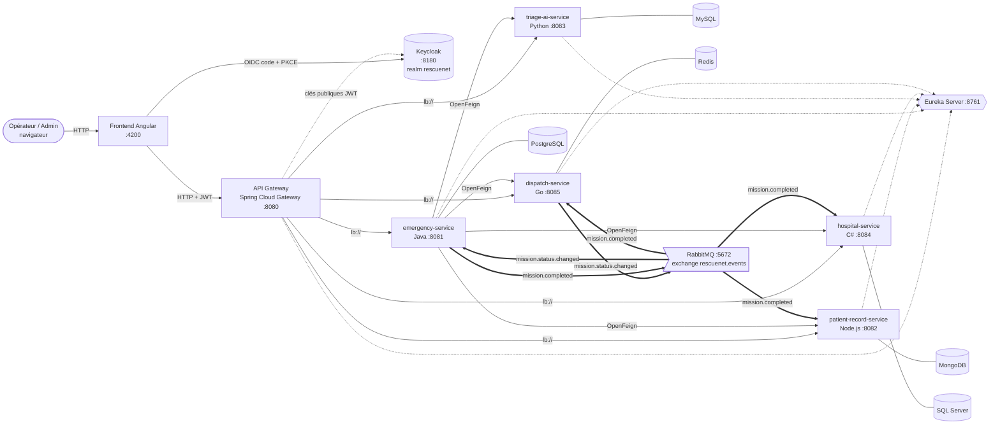
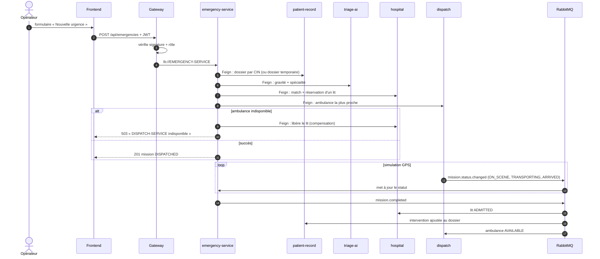
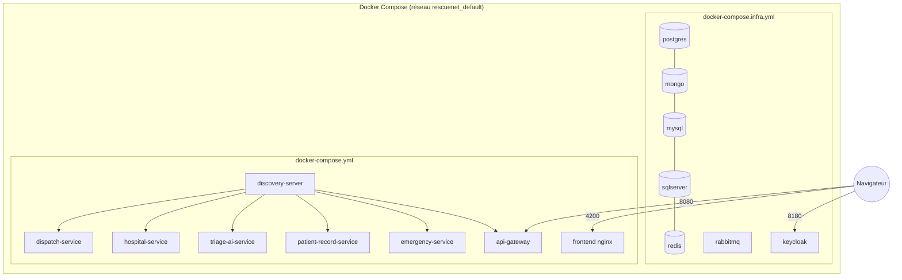
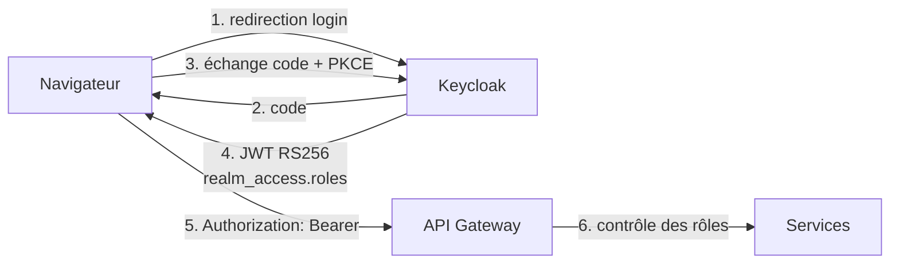

# Architecture de RescueNet

> Livrable « Validation 1 » (diagramme d'architecture). Les diagrammes sont en Mermaid : ils s'affichent directement sur GitHub.

## 1. Vue d'ensemble

Légende : trait plein = appel synchrone, trait pointillé = enregistrement / résolution Eureka ou clés publiques, trait épais = événement asynchrone RabbitMQ.

## 2. Une base par service (polyglotte)

| Service | Langage | Base | Pourquoi ce choix |
|---|---|---|---|
| emergency-service | Java 21 / Spring Boot | PostgreSQL | missions et statuts : données relationnelles, transactions |
| patient-record-service | Node.js / Express | MongoDB | dossier médical : document flexible (listes, historique imbriqué) |
| triage-ai-service | Python / FastAPI | MySQL | écosystème scikit-learn ; historique des triages |
| hospital-service | C# / .NET 10 | SQL Server | lits : décrément atomique `ExecuteUpdate` |
| dispatch-service | Go / Gin | Redis | `GEOSEARCH` : ambulance la plus proche, très faible latence |

Aucun service n'accède à la base d'un autre : toute donnée d'un autre domaine passe par son API ou par un événement.

## 3. Saga d'une urgence (communication synchrone puis asynchrone)

## 4. Déploiement

Deux modes :
- **Conteneurs** : `docker compose up -d --build` (tout dans Docker).
- **Développement** : `docker-compose.infra.yml` (bases, RabbitMQ, Keycloak) + `scripts\start-all.ps1` (services en processus locaux, rechargement rapide).

## 5. Sécurité

| Route (via Gateway) | OPERATEUR | ADMIN |
|---|---|---|
| `POST/GET /api/emergencies/**` | oui | oui |
| `GET /api/patients/**`, `/api/hospitals/**`, `/api/dispatch/**` | oui | oui |
| `POST/PUT /api/patients/**` | non (403) | oui |
| `/api/triage/**`, `/actuator/**` | non (403) | oui |
| sans jeton | 401 | 401 |

## 6. Choix de conception à retenir

- **Couplage faible** : aucune URL en dur, tout passe par les noms Eureka (`lb://NOM`, `@FeignClient(name=...)`).
- **Saga orchestrée avec compensation** : pas de transaction distribuée ; le lit réservé est libéré si l'ambulance échoue.
- **Asynchrone là où l'on n'attend pas de réponse** : suivi de mission et clôture passent par RabbitMQ.
- **Résilience** : timeouts (2 s connexion, 6 s lecture), une nouvelle tentative, jamais de rejeu après timeout sur un appel non idempotent.
